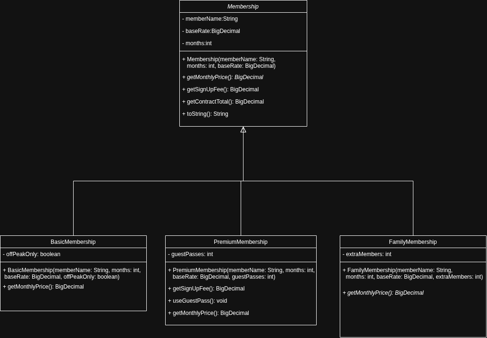
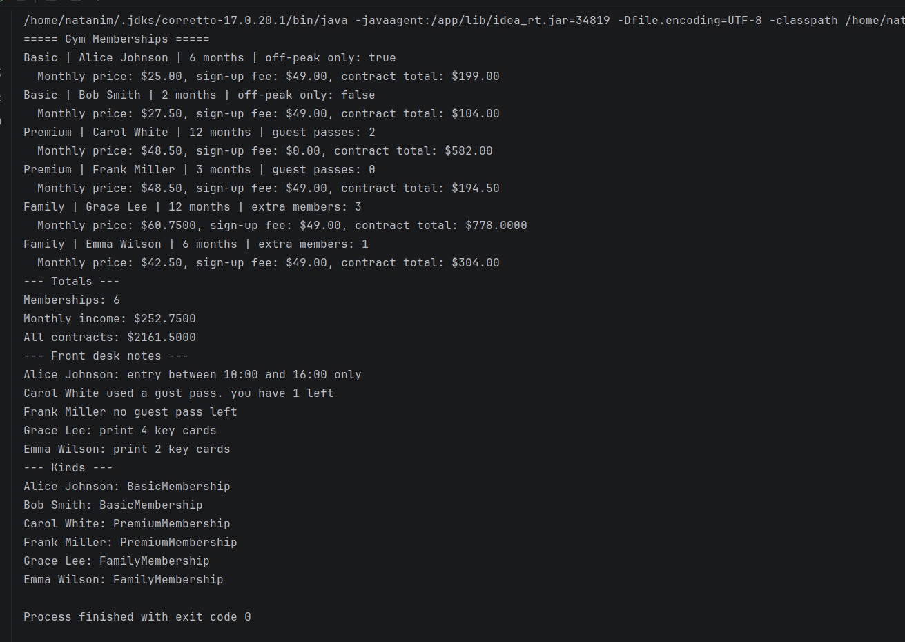

# Gym Memberships
A gym membership management app that tracks memberships and their payments
## Description of the Project

This is a gym membership project. It shows the gym members and the membership types. 
There are three types: Basic, Premium, and Family. Each type has its own monthly price. 
It also shows the sign-up fee and the contract total

## Class Diagram

<!-- OPTIONAL. Only when the project asks for one (Capstone 2 onward). Export the diagram as a PNG into the
     images folder and keep the line below. If your project has no class diagram, delete this whole section,
     heading included. -->



## Features

- Creates Basic, Premium and Family memberships
- Works out each monthly price, sign-up fee and contract total
- Lets Premium members use guest passes
- Shows the monthly income and the total of all contracts


## Setup

### Prerequisites

- Java 17 (Amazon Corretto), the version used in class.
- IntelliJ IDEA Community Edition: <https://www.jetbrains.com/idea/download/>

### Running the application

1. Clone this repository, or download it as a zip and unzip it.
2. In IntelliJ: File > Open, pick the project folder (the one that holds `pom.xml`), press Open.
3. Wait for IntelliJ to finish indexing (progress bar at the bottom).
4. Open `src/main/java/com/pluralsight/Main.java`. 
5. Right-click inside the file and choose Run 'Main.main()'.

## Technologies Used

- Java 17
- IntelliJ IDEA

## Demo

<!-- Pictures of the app running: the console for a console app, Insomnia or Swagger for an API.
     Screenshots are enough; a GIF is a bonus.
     1. Create a folder named `images` at the project root, next to `pom.xml`.
     2. Take screenshots of the app in the IntelliJ console (the menu, one feature, one error message):
          Windows: Win + Shift + S, drag a rectangle, then paste into Paint and save as PNG, or open the
                   notification and save. Save into the `images` folder.
          Mac:     Shift + Cmd + 4, drag a rectangle. The file lands on the Desktop; move it into `images`.
     3. Name the files by what they show: `images/menu.png`, `images/search.png`.
     4. Reference each one below with a relative path. No spaces in file names.
     5. Commit the images with the rest of your work (Git > Commit shows them as unversioned files: tick them).
     Optional GIF: LICEcap (free, Windows and Mac, <https://www.cockos.com/licecap/>) records a region of the
     screen straight to a .gif. Keep it under 10 seconds and under 10 MB, save it into `images`. -->



## A piece of code I am proud of


```java
 public void useGuestPass(){
        if (guestPasses > 0){
            guestPasses--;
            System.out.println(getMemberName() + " used a gust pass. you have " + guestPasses + " left");
        }else {
            System.out.println(getMemberName() + " no guest pass left");

        }
    }
```
This method lets a Premium member use a guest pass. 
It takes one pass away and prints how many are left.

## Future Work

- Add a fourth kind, Corporate membership (the bonus)
- Let the user type in members instead of using fixed sample data

## Resources
- Java YearUp Fall 2026 hub: <https://raymaroun.github.io/yearup-java-fall2026/>
-

## Author

<!-- Your name and, if you like, your GitHub profile link. For a team workshop, one line per person with what each one built. -->

- **Natanim Mekuria**

## Thanks

<!-- Optional. The people who helped: the instructor, a classmate who debugged with you, a mentor. -->

- Thank you to my instructor for the help and clear instructions in this class
